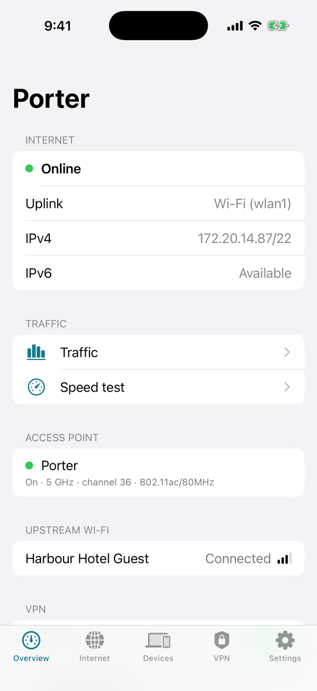
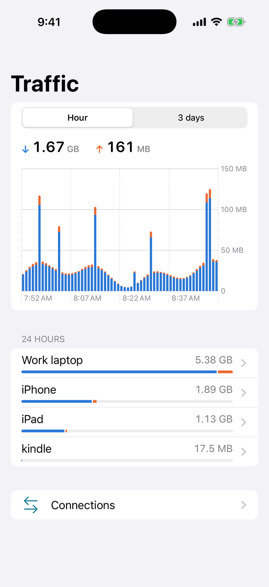
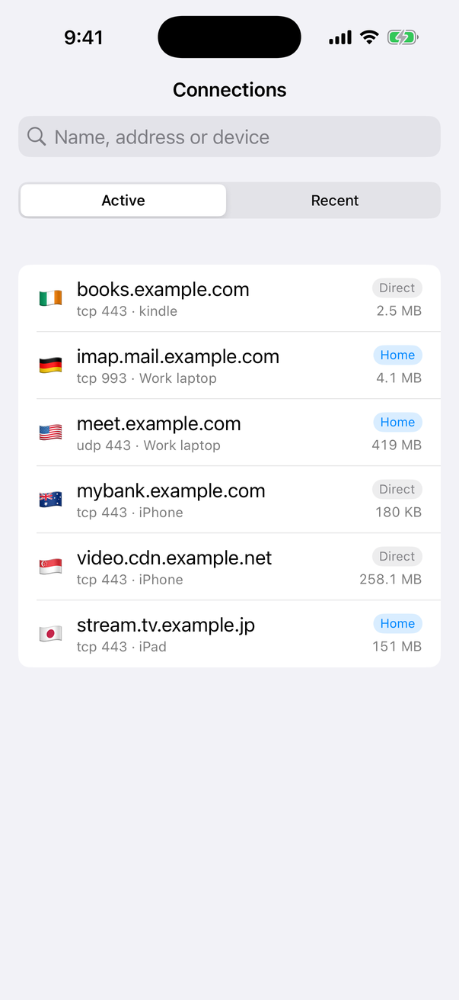
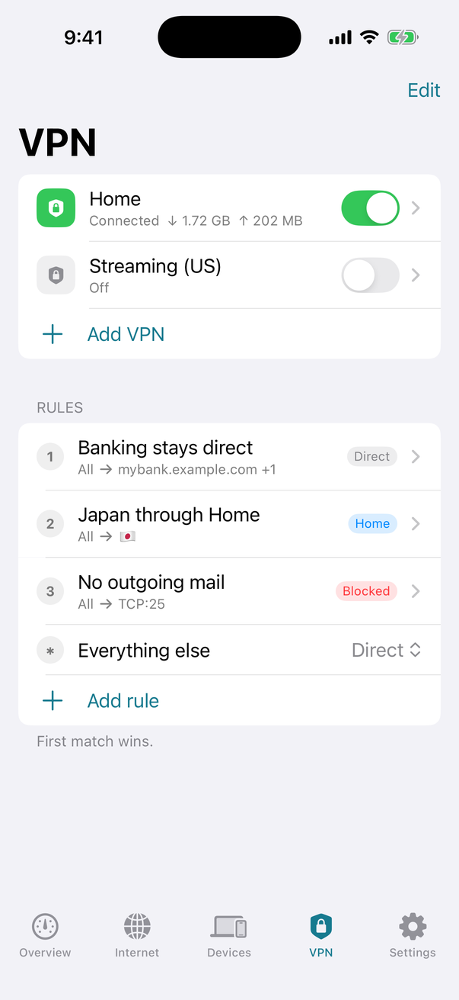

# Porter

A travel router you build from a Raspberry Pi 5 and control from your
iPhone.

Plug it in at a hotel, café or Airbnb and it gives all your devices one
private Wi-Fi network of their own: it joins the venue's network (or a
wired port) for you, gets through the sign-in page once for everything,
and can send some or all of your traffic through your VPN.

<p>




</p>

- **Your own network anywhere.** Wired or Wi-Fi uplink; the built-in
  radio, a USB Wi-Fi adapter, or both, in whichever roles you choose.
- **Controlled over Bluetooth.** The app talks to the router directly,
  so it works whether or not anything has internet yet. No account, no
  cloud service: the router and the app are the only two parts.
- **Sign-in pages handled once.** One device signs in to the venue's
  network; every device behind the router is then online.
- **VPN with rules.** WireGuard, with a kill switch. Send everything
  through it, or only certain devices, sites, countries or ports.
- **See and manage what is connected.** Per-device traffic, live
  connections, pause a device, block ads for the whole network, run a
  speed test.
- **IPv6** works too, wherever the upstream network offers it.

## What you need

- A **Raspberry Pi 5** with its power supply (any RAM size)
- A **microSD card**, 4 GB or larger
- An **iPhone** on iOS 17 or later
- A **Mac with Xcode 16** or later, to put the app on your phone
- Optional: an Ethernet cable for a wired uplink, a USB Wi-Fi adapter
  for a second radio, a micro-HDMI cable and keyboard for troubleshooting

## 1. Flash the router

1. Download `porter-<version>.img.xz` from the
   [latest release](https://github.com/ryanzhou/porter/releases/latest).
   (Or [build it yourself](docs/DEVELOPMENT.md).)
2. Open [Raspberry Pi Imager](https://www.raspberrypi.com/software/).
   Choose **Raspberry Pi 5**, then **Use custom** and select the
   `.img.xz` file, then your SD card. When asked about OS customisation,
   choose **No**.
3. Put the card in the Pi and plug in power.

After about a minute the green light blinks slowly: the router is waiting
to be set up.

## 2. Install the app on your iPhone

The app is installed from source with Xcode. A free Apple ID is enough;
you do not need a paid developer account.

1. Download this repository to your Mac and open Xcode.
2. In **Xcode → Settings → Accounts**, add your Apple ID.
3. In the `ios` folder, copy `Local.xcconfig.example` to
   `Local.xcconfig` and fill in the two values it describes: your Team ID
   and a bundle identifier of your own, such as `com.yourname.porter`.
   (Xcode shows your Team ID next to your account; the file itself
   explains where else to find it.)
4. Open `ios/Porter.xcodeproj`. Connect your iPhone with a cable, choose
   it at the top of the Xcode window, and press **Run** (▶).
5. The first time, your iPhone asks you to turn on **Developer Mode**
   (Settings → Privacy & Security) and to trust your certificate
   (Settings → General → VPN & Device Management). Do both, then press
   Run again.

With a free Apple ID the app stops opening after 7 days. Connect the
phone and press Run again to renew it; nothing is lost.

Want to look around first? In Xcode choose **Product → Scheme → Edit
Scheme → Run → Arguments**, add `-demo`, and run in the Simulator. The
app then shows sample data and needs neither a router nor an Apple ID.

## 3. Set up the router

1. Stand near the Pi and open the app. Allow Bluetooth when asked.
2. Tap **Porter** in the list. A new router pairs with the first phone
   that connects.
3. Choose a **Wi-Fi name**, a **password** and your **country** (it
   decides which Wi-Fi channels are legal), then tap **Start**.
4. Join that Wi-Fi network from your devices. The QR button on
   **Overview** shows a code they can scan instead of typing.

Out of the box the built-in radio is your Wi-Fi network and the Ethernet
port is the uplink. If you have a cable, plug it in and you are online.
If not, read on.

## Getting online

Everything here is on the **Internet** tab.

| You have | Do this |
|---|---|
| A wired port | Plug in Ethernet. Nothing else to do. |
| Wi-Fi only, Pi alone | Set the built-in radio's role to **Both**, tap **Scan**, and join the network. Your own network briefly drops while it moves to the same channel. |
| Wi-Fi only, plus a USB Wi-Fi adapter | Give the adapter the **Uplink** role, scan and join. The built-in radio stays your network. This is faster and steadier than one radio doing both. |
| Only your phone's data | Turn on Personal Hotspot and join it as above. |

Networks you have joined are remembered and rejoined automatically. If
the venue's network uses the same address range as yours, the router
moves your network out of the way by itself.

Where a network is on both bands the router joins it on 5 GHz, unless
that signal is poor; the band shows next to the uplink. With one radio
doing both jobs, your own network follows the uplink onto its channel,
and 5 GHz is only used on channels where an access point is allowed
(venues often use the radar channels, which are not). A second adapter
has no such limit.

### Sign-in pages (captive portals)

When the venue wants you to accept terms or enter a room number,
**Overview** shows **Sign-in required**. One of your devices does the
signing in, for everyone:

- On the device named there, connected to *your* Wi-Fi, tap **Open
  sign-in page** (or just open any website). Complete the page.
- If nothing appears, tap **Reconnect**: that device rejoins your
  Wi-Fi and its own sign-in sheet pops up.
- To use a different device, pick it from the menu on the same card.

Once the venue lets the router through, every device is online and the
section disappears. Until then only the sign-in device can reach the
venue's network; devices you have put behind a VPN kill switch stay
protected.

## Using a VPN

On the **VPN** tab tap **Add VPN** and paste the WireGuard configuration
from your VPN provider or your own server (or import the `.conf` file).

- **Everything through the VPN:** set **Everything else**, the last row
  of the rules, to that VPN.
- **One device:** open it on the **Devices** tab and set its **Route**.
- **Some destinations:** tap **Add rule** and choose sources (devices)
  and destinations (domains, address ranges, countries, ports), then
  where that traffic goes: a VPN, **Direct**, or **Blocked**.

Rules are numbered in the order they are checked and the first match
wins; then the device's own route; then **Everything else**. Tap **Edit**
to reorder, swipe a rule right to turn it off.

**Kill switch** (per VPN, on by default): if the tunnel is down, traffic
meant for it is stopped rather than sent out unprotected.

DNS lookups follow the traffic: a device routed through a VPN uses that
VPN's DNS server.

## Everyday things

- **Devices.** See what is connected, rename it, **pause** its internet,
  give it a fixed address, see what it has been looking up.
- **Ad blocking.** Settings → Ad blocking. Blocks ad and tracker domains
  for every device. If a site breaks, add it under **Always allow**, or
  turn on **Skip ad blocking** for one device.
- **Traffic.** Overview → Traffic shows how much each device has used;
  **Connections** shows what each is talking to right now, in which
  country, and whether it went through the VPN.
- **Speed test.** Overview → Speed test measures the router's own
  connection, directly or through a VPN. (It measures the venue's
  internet, not the Wi-Fi between you and the router.)
- **Another phone.** Briefly press the Pi's power button; the light
  blinks fast for two minutes while a new phone can pair. Or use
  Settings → Phones. Remove a phone there too.
- **Turning it off.** Hold the power button for a second and release, or
  use Settings → Power off. Simply pulling the plug is safe as well: the
  system is read-only and cannot be corrupted that way.

### The light and the button

| Green light | Meaning |
|---|---|
| Slow blink | Waiting for first-time setup |
| Fast blink | A new phone can pair (2 minutes) |
| Steady | Running normally |

| Power button | Does |
|---|---|
| Short press | Lets a new phone pair |
| Hold 1 second, release | Shuts down |
| Press while off | Starts up |

## Troubleshooting

**The router does not appear in the app.** Give it a full minute after
power-on and stay within a few metres. Check that Bluetooth is on and
that the app is allowed to use it (Settings → Porter). If the light is
not blinking at all, the Pi did not boot: re-flash the card.

**"Press the power button".** The router already belongs to another
phone. Press the button briefly, then try again.

**The app stopped opening.** With a free Apple ID that happens after 7
days. Connect the phone to your Mac and press Run in Xcode.

**No Wi-Fi network appears after setup.** Open **Overview** and look at
the Wi-Fi card for an error, and check the country is right.

**Online, but a device has no internet.** Check it is not paused, and
whether it is routed through a VPN that is down (kill switch).

**Seeing what the router is doing.** Put the SD card in your computer
and create an empty file named `porter-debug` on the `BOOTFS` volume.
Boot the Pi with a display (micro-HDMI) and keyboard attached: you get a
command line as root. Useful commands:

```bash
porterctl status
```

```bash
journalctl -u porterd -b --no-pager | tail -60
```

```bash
bluetoothctl show
```

The first shows what the router thinks is happening, the second its log,
the third whether Bluetooth is up. If Bluetooth is the problem you can
still do first-time setup from there:

```bash
porterctl config | sed -e 's/"country": ""/"country": "AU"/' -e 's/"ssid": ""/"ssid": "MyNetwork"/' -e 's/"passphrase": ""/"passphrase": "choose-a-password"/' > /tmp/c.json
```

```bash
porterctl call config.set "{\"config\": $(cat /tmp/c.json)}"
```

Delete the `porter-debug` file when you are done.

**Starting over.** Settings → Reset erases all
settings and pairings. Re-flashing the card does the same.

## Good to know

- **Updating.** Settings → Software shows the router's version and
  whether a newer [release](https://github.com/ryanzhou/porter/releases)
  exists; **Install** downloads it, restarts into it and keeps your
  settings. The card holds the system twice: the update goes into the
  spare copy, and if the new version does not come up properly the
  router goes back to the one before. The router only looks for updates
  when you open that page. Update the app from the same version of the
  source. (A card flashed before v0.1.0 has to be flashed once more.)
- **What the router contacts by itself:** a time server; one small page
  on `captive.apple.com` to detect sign-in pages (the same check an
  iPhone makes); your chosen ad block lists, daily, when ad blocking is
  on; and a country database from db-ip.com, monthly. A speed test
  contacts its test server only when you run one, and the router asks
  github.com for a newer version only when you open Settings → Software. Nothing reports to
  the authors of this project; there is nowhere for it to report to.
- **Security.** The app's connection to the router is encrypted and
  authenticated independently of Bluetooth pairing, and a phone can only
  pair while the router is new or its button has just been pressed.
  There are no passwords to log in to the router itself; SSH is off
  unless you enable it in Settings, and then only from your own network
  with your key.
- **Ad blocking** works by refusing to look up ad domains. It cannot
  remove ads served from the same place as the content, and a device
  using its own encrypted DNS bypasses it.
- **Country rules** use a public database that is approximate. Global
  services such as public DNS resolvers appear under a single country.
- **IPv6** is provided by address translation. Your devices get private
  IPv6 addresses, so for sites that have both, most devices will prefer
  IPv4; IPv6-only sites work.
- **USB Wi-Fi adapters** that draw a lot of power may need a 5 A power
  supply, or `usb_max_current_enable=1` in `config.txt` on the card.
- **Many devices on the built-in radio.** The Pi's Wi-Fi chip supports
  only a handful of simultaneous clients with its default firmware.
  [The developer notes](docs/DEVELOPMENT.md#built-in-radio-client-limit)
  describe the alternative firmware.
- **Not included:** OpenVPN, a VPN server, enterprise (username and
  password) Wi-Fi as the uplink, intrusion detection, load balancing
  across several uplinks.

## For developers

How it is built, how to build the image yourself, the tests, and the
control protocol are in [docs/DEVELOPMENT.md](docs/DEVELOPMENT.md) and
[docs/PROTOCOL.md](docs/PROTOCOL.md).

## Licence

[Apache 2.0](LICENSE). [NOTICE](NOTICE) lists the third-party software
and data Porter uses; the software inside a built SD card image keeps its
own licences.

IP geolocation by [DB-IP](https://db-ip.com).
